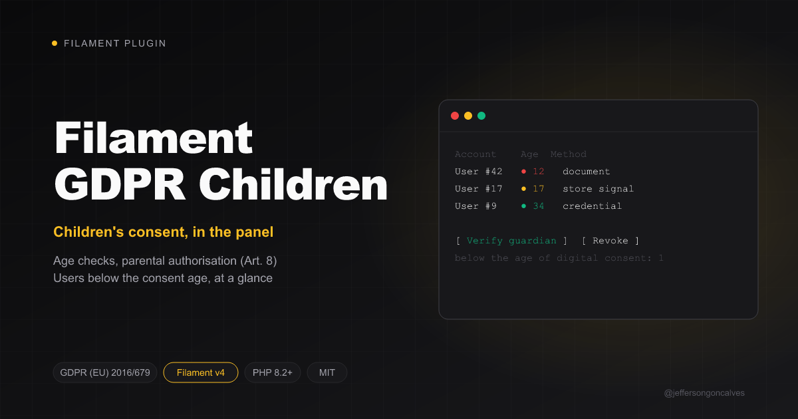

<div class="filament-hidden">



</div>

# Filament GDPR Children

[](https://packagist.org/packages/jeffersongoncalves/filament-gdpr-children)
[](https://github.com/jeffersongoncalves/filament-gdpr-children/actions?query=workflow%3Atests+branch%3A2.x)
[](https://github.com/jeffersongoncalves/filament-gdpr-children/actions?query=workflow%3A"Fix+PHP+code+styling"+branch%3A2.x)
[](https://packagist.org/packages/jeffersongoncalves/filament-gdpr-children)
[](LICENSE.md)

Manage the GDPR children's consent records (Art. 8) kept by [laravel-gdpr-children](https://github.com/jeffersongoncalves/laravel-gdpr-children) in your Filament panel.

## Features

- **Age checks:** a read-only list of each result, with the age at the check, the method (marked as reliable or not), the provider and the expiry date. Filter the users below the age of digital consent. Your app's age check flow records them. Nobody types them in by hand.
- **Guardian links:** link a child's account to the holder of parental responsibility, then verify or revoke the link (Art. 8(2)). Once verified, the child's consent counts.
- English (more languages coming).

## Compatibility

| Plugin Version                                                              | Filament |
|-----------------------------------------------------------------------------|----------|
| [1.x](https://github.com/jeffersongoncalves/filament-gdpr-children/tree/1.x) | 3.x      |
| [2.x](https://github.com/jeffersongoncalves/filament-gdpr-children/tree/2.x) | 4.x      |
| [3.x](https://github.com/jeffersongoncalves/filament-gdpr-children/tree/3.x) | 5.x      |

## Installation

You can install the package via composer:

```bash
composer require jeffersongoncalves/filament-gdpr-children:"^2.0"
php artisan vendor:publish --tag="gdpr-children-migrations"
php artisan migrate
```

## Usage

```php
use JeffersonGoncalves\Filament\GdprChildren\GdprChildrenPlugin;

public function panel(Panel $panel): Panel
{
    return $panel
        ->plugins([
            GdprChildrenPlugin::make()
                ->navigationGroup('GDPR')            // default: no group
                ->navigationSort(7)
                ->subjectModel(\App\Models\User::class)  // default: auth.providers.users.model
                ->subjectTitleAttribute('name'),     // shown next to the id and used to search accounts
        ]);
}
```

All fluent methods are optional.

> The resources have no authorization of their own. Register them only on panels whose users handle privacy, or add policies for the `JeffersonGoncalves\GdprChildren\Models\*` models.

## Testing

```bash
composer test
```

## Changelog

Please see [CHANGELOG](CHANGELOG.md) for more information on what has changed recently.

## Contributing

Please see [CONTRIBUTING](.github/CONTRIBUTING.md) for details.

## Security Vulnerabilities

Please review [our security policy](../../security/policy) on how to report security vulnerabilities.

## Credits

- [Jefferson Gonçalves](https://github.com/jeffersongoncalves)
- [All Contributors](../../contributors)

## License

The MIT License (MIT). Please see [License File](LICENSE.md) for more information.
